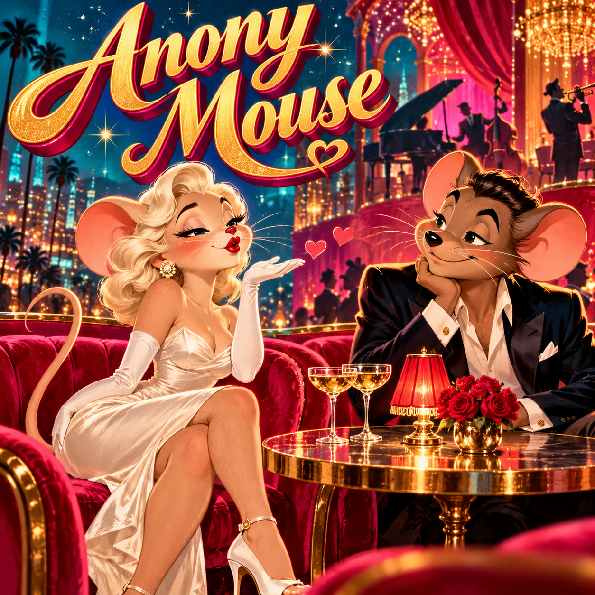

# Anony Mouse

A super simple dating app for adults seeking flirtation, sex and connection.

**A little about you. A little about what you want. See who answers.**

Latest proposal: one free month at launch, then £25 for one year, with £25 annual renewals. The live concept preview still shows the original one-off price; updating it is the first item on the [TODO list](TODO.md). This is a proposed business model, not an operating service.

## The idea

- Describe who you are and what you want.
- Choose a pseudonym and a profile image; the image need not identify you.
- Enter a partial postcode such as GU2; explore gently pulsing potential matches and patron-written hints on a map.
- Browse profiles and exchange private messages and images.
- Messages and attachments automatically expire after two weeks unless saved as keepsakes.
- Each patron may retain up to 100 keepsake messages.
- No verification of patrons' identity claims. Caveat emptor.

Discretion from the neighbours is the aim. Patrons control what they disclose, but other people may recognise them or copy what they receive. Identity claims are unverified; absolute anonymity is not promised.

## Project status

Interactive static concept preview: fictional postcode matches, scripted chat, session-only keepsakes and a two-step signup demo. No real accounts, payment collection or production messaging service yet.

Open `index.html` to explore the design. GitHub Pages publishes the project from the root of `main`. The commercial service will require suitable backend hosting; GitHub Pages is not the paid-service host.

The prototype uses no analytics or browser storage. Form details, selected pictures and keepsakes remain in page memory and disappear on reload. A stylesheet requests optional Google Fonts; no form contents are sent to Google.

See [the product brief](docs/product-brief.md) for scope and [the prioritised TODO list](TODO.md) for implementation and national launch planning.

## Artwork

Masthead created with AI for Anony Mouse: a glamorous adult female mouse blowing a Monroe-style kiss to a suave adult male mouse, in saturated Technicolor.

## Ownership

Project by Andy J Myers. No open-source licence has been granted at this stage.
